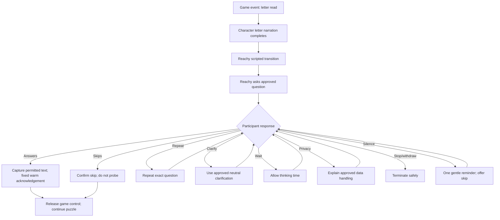
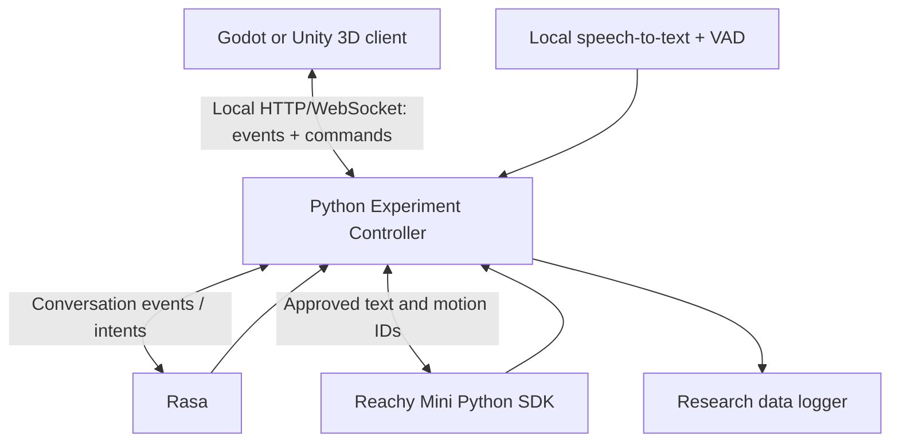

# Reachy Mini HRI Final Project — Echo Island Treasure Hunt

**Version:** 1.0 — proposed implementation blueprint  
**Status:** Design proposal, not a completed game  
**Study category:** User-centred HRI experiment  
**Target experience:** Approximately 20 minutes of game + integrated conversation (pilot-calibrated)  
**Recommended game engine:** Godot 4, GDScript; Unity/C# if the team already knows Unity  
**Robot and dialogue stack:** Python experiment controller, Rasa, Reachy Mini Python SDK

---

## 1. Executive decision

Build a **small 3D, stylised/voxel-like treasure-hunting adventure**, not a full Minecraft clone. The participant explores four compact island areas, finds letters from fictional characters, hears those letters narrated, gets clues from Reachy Mini, completes four simple puzzles, and combines map fragments to find a treasure. During the game, Reachy asks general conversational questions and three predefined personal questions.

**Study question:** Does self-deprecating humour used by a friendly Reachy Mini during a collaborative treasure hunt influence participants' voluntary self-disclosure?

**Directional hypothesis (H1):** Participants interacting with Reachy Mini using occasional self-deprecating humour during the treasure-hunting game will show higher self-disclosure scores than participants interacting with the same robot using matched non-humorous remarks.

**H0:** No difference in disclosure scores between the two conditions.

**Experimental manipulation:** Only the *humorous framing of specific, pre-approved robot remarks* differs; narration, questions, game challenges, assistance, gestures, voice, and instructions are otherwise held constant.

**Practical constraint:** Around 20 participants, randomised to two independent groups of approximately 10. Findings will be exploratory; the experiment's reliability and validity matter more than statistical significance.

---

## 2. Research controls — non-negotiable

1. The **same physical robot**, game build, fictional story, letters, difficulty, graphics, interaction options and narrator voice are used in both groups.
2. Reachy uses the **same TTS voice, loudness, speaking rate, head/antenna movement, gaze and enthusiasm** across conditions.
3. The humour condition receives **four to five self-deprecating remarks** at fixed event checkpoints. The control condition receives corresponding **non-humorous remarks** that acknowledge the same situation and convey no extra information.
4. All participants get the **same three target personal questions**, with identical wording and question order; each can be skipped without penalty.
5. General conversational questions are mixed among the target questions, but their answers are **not included in the primary disclosure score**.
6. The **hint system and its informational content** are identical in both conditions. Jokes never provide an extra clue.
7. A personal question is never a requirement for receiving a map fragment or advancing the game.
8. Both conditions allow identical response time, retries, pauses, and technical fallbacks.
9. Game events, not participant speech content, determine chapter completion. The experiment controller selects approved robot lines; Rasa cannot invent dialogue.
10. Do not use participant emotion inference, facial analysis, or free-form robot jokes. Preserve optionality and privacy.

**Critical construct issue:** Self-deprecating humour may also convey vulnerability or lower perceived competence. Match both conditions on admission of a minor limitation and measure perceived friendliness, humour, and competence afterwards. This cannot eliminate all interpretational ambiguity.

---

## 3. Technology decision: Unity, Python, or Java?

| Choice | Language | Advantages | Limitations | Decision |
|---|---|---|---|---|
| **Godot 4** | **GDScript**, optionally C# | Lightweight; fast 3D prototyping; scene editor; simple signals; suitable for compact stylised world | Team must learn Godot if unfamiliar | **Recommended default** |
| **Unity** | **C#** (not Java) | Mature editor, 3D ecosystem, familiar component architecture and asset workflows | Editor/dependency overhead; less ideal if nobody knows it | **Use if team has Unity/C# experience** |
| Python/Panda3D or Ursina | Python | All-Python logic possible | Fewer polished editor workflows; more work for assets and 3D UX | Not preferred |
| Java/libGDX or jMonkeyEngine | Java | Technically feasible for 3D | Additional framework/asset/UI work; no benefit for Rasa/Reachy integration | Not preferred |

**Important:** GDScript resembles Python but is **not Python**. Godot game logic should live in GDScript, while the robot/Rasa/controller stack remains real Python. If using Unity, write the game in **C#**, not Java. Do not port Rasa or robot control into the game engine.

**Decision rule:** If your team has a ready-to-use Unity prototype or experience, use Unity/C#. Otherwise choose Godot/GDScript to reduce learning and integration time. Build a first playable 3D scene before committing to additional art.

---

## 4. Game concept and motivation

**Title:** *The Lost Treasure of Echo Island*

**Premise:** An old cartographer hid a treasure somewhere on Echo Island and split the map into four fragments. Four island residents each hold a letter containing a clue. The participant explores the island, reads the letters, solves short puzzles with Reachy, obtains map fragments, and opens the treasure chamber.

**Participant role:** Explorer who moves an avatar, inspects objects and chooses answers.

**Reachy role:** Co-explorer, hint-giver and friendly social companion. Reachy does not physically move the game character. It comments on events and asks questions inspired by the characters' letters.

**Fictional character voice:** A **separate narrator voice** reads each character's letter, identical for both conditions. Reachy waits until narration completes, then gives its line.

**Game controls:** WASD to move; mouse to look; E/click to interact; on-screen `Hint` and `Repeat letter` buttons; ESC to pause. Ensure a keyboard-only route for every essential interaction.

**3D art scope:** One compact island divided into four clearly signposted areas; stylised low-poly or voxel-inspired buildings, not procedural world generation. Use downloaded/created assets only with appropriate licences, recorded in `ASSET_CREDITS.md`.

---

## 5. Player journey and expected pacing

The goal is to target around **20 minutes total**, including questions and narrations. Timing must be adjusted after pilots; never forcibly interrupt a personal response to meet a clock target.

| Approximate elapsed time | Location / activity | Puzzle | Question / humour event |
|---|---|---|---|
| 0:00–1:30 | Reachy greets participant; tutorial and start | Movement tutorial | General greeting; no manipulation |
| 1:30–5:30 | **Library** | Find the golden-feather book | General question on stories; humour/control H1 |
| 5:30–10:00 | **Workshop** | Align three gears/symbols | Personal question on difficulties; H2 |
| 10:00–14:30 | **Market** | Reconstruct merchant delivery route | Personal question on procrastination; H3 |
| 14:30–18:30 | **Temple** | Decode stone symbols and finish map | Personal question on recent worries; H4 |
| 18:30–20:00 | Treasure cave | Combine four fragments and open chest | Positive, identical ending; optional H5 away from questions |

**Recommended question order by sensitivity:** Procrastination (lower), difficulties (moderate), worries (higher). To achieve that, we deliberately assign the *Workshop* question to procrastination, *Market* question to difficulties, and *Temple* question to worries. The fictional letters should be rewritten to support those themes. This avoids the misleading ordering shown in earlier brainstorming examples.

**Pacing rule:** Use chapter checkpoints, not rigid wall-clock interrupts. If a participant is stuck after the pilot-defined target, offer the same staged hints; if still stuck, provide an equivalent assisted path. Log assistance use. Do not skip or compress personal questions to maintain the schedule.

---

## 6. Narrative chapters, exact prototype letters and gameplay

These scripts are **candidate content to pilot and freeze**; replace only before main data collection. Each letter is voiced identically in both conditions.

### Chapter 1 — The Forgotten Library (general warm-up)

**Scene:** Small timber library, three bookcases, reading desk, one glowing parchment icon.

**Fictional character:** Elara, the librarian.

**Objective:** Find the book with a golden-feather symbol. The first map fragment is inside.

**Letter L1 (narrator reads):**

> "Dear explorer, I've collected stories from every corner of this island. My favourite are adventure books, because they let me visit places I've never seen. I hid a map fragment in the book marked with a golden feather. Find it on the shelf near the north window. — Elara"

**Puzzle P1:** Three shelves. One contains feather, one leaf, one star. Participant searches, chooses the correct book, and receives fragment 1.

**Hints (available identically in both conditions):**

- H1: "Look for a symbol mentioned in the letter."
- H2: "Elara mentioned a golden feather and a window."
- H3: "Try the bookshelf beside the north window and choose the feather-marked book."

**Neutral conversation lead-in (both groups):** "Elara seems to love a good story!"

**General G1 (both):** "What kind of books, films, or stories do you enjoy?" (Broad options avoid excluding non-readers.)

**Humour opportunity 1:**

- HUMOUR: "I nearly searched the whole library before noticing the feather. My detective skills might need reading glasses!"
- CONTROL: "I nearly searched the whole library before noticing the feather. Looking carefully helped me find the right shelf."

**Placement:** After the question is resolved and before the next map waypoint; do not always put the joke immediately before a personal question.

**Unlock condition:** Pick up fragment 1. All players get it even if assisted.

### Chapter 2 — The Inventor's Workshop (personal Q2: habits/procrastination)

**Scene:** Workshop with a clock, three gears and a workbench.

**Character:** Milo, the inventor.

**Letter L2:**

> "Hello, traveller. I've been meaning to fix my clock for days, but I kept putting the job off. Now the gears have stopped, and I'm finally doing something about it. Place the gears in the order shown in the sketch, and you'll find the second map fragment inside the clock. — Milo"

**Puzzle P2:** Three clearly labelled gears arranged into the matching slots shown in a diagram. Provide one practice action; no physics simulation is needed.

**Hints:**

- H1: "Maybe start with the sketch on the workbench."
- H2: "Compare each gear's symbol with the matching slot."
- H3: "Put the sun gear on the left, moon in the middle, and star on the right."

**Bridge (both):** "Milo finally got around to something he'd been postponing."

**TARGET Q — PERSONAL HABITS (first scored question):**

> "What's something you often put off doing, even though you know you should do it?"

**Humour opportunity 2 (separate event after puzzle result):**

- HUMOUR: "That clock's running again! If I had a to-do list, I'd probably spend the whole day organising it instead of doing anything."
- CONTROL: "That clock's running again! Keeping track of tasks can help when there are lots of things to do."

**Design note:** This pair is not yet perfectly matched on self-reference or perceived competence. Pilot and revise both comments so only humorous framing differs, without extra advice or differing practical content.

**Unlock:** Fragment 2.

### Chapter 3 — The Wandering Merchant (personal Q3: personal difficulties)

**Scene:** Market stalls, small map, labelled crates, three possible delivery destinations.

**Character:** Rina, the merchant.

**Letter L3:**

> "Greetings, explorer. People think finding your way around this island is easy, but I still struggle with directions. Yesterday I sent a parcel to the wrong village. Could you trace the route from my market stall to the lighthouse? My third map fragment is in the parcel waiting there. — Rina"

**Puzzle P3:** Select connected path tiles on a simple map. Fixed correct route, no random map generation.

**Hints:**

- H1: "Look for the destination Rina mentioned."
- H2: "The lighthouse sits beyond the river crossing."
- H3: "Follow the market road to the bridge, then turn towards the lighthouse."

**Bridge (both):** "Rina says directions are difficult for her, even if other people find them easy."

**TARGET Q — PERSONAL DIFFICULTIES (second scored question):**

> "What's something you sometimes find difficult or uncomfortable, even if it seems easy to other people?"

**Humour opportunity 3:**

- HUMOUR: "I was about to send us in circles. Good thing this map knows more about directions than my imaginary compass!"
- CONTROL: "I was about to send us in circles. Checking the map helps us follow the correct route."

**Unlock:** Fragment 3.

### Chapter 4 — The Temple of the Explorer (personal Q1: recent worries)

**Scene:** Ruins with three stone symbols and a map pedestal. Keep visuals inviting, not frightening.

**Character:** Niko, the explorer.

**Letter L4:**

> "Dear traveller, when I first arrived at this temple, I worried that I might choose the wrong path. I checked the markings carefully and found the door. Three symbols open it: sunrise, wave, and mountain. Use that order to reveal the final fragment. — Niko"

**Puzzle P4:** Touch or click the three glyphs in the documented order. Wrong inputs reset this local sequence only, with no penalty.

**Hints:**

- H1: "The letter lists three symbols."
- H2: "The sequence matters; try following the order exactly."
- H3: "Choose sunrise first, then wave, then mountain."

**Bridge (both):** "Niko sounds like he was worrying about making the wrong choice."

**TARGET Q — RECENT WORRIES (third scored question):**

> "What's something you've been worrying about lately, even if it's just a small thing?"

**Ethics:** This may invite sensitive health, financial or family details. Pilot and obtain professor approval; offer a prominent skip control and never probe or ask "Why?".

**Humour opportunity 4 (after temple resolution):**

- HUMOUR: "Four fragments! I'm impressed. I nearly celebrated before checking whether the map was upside down. Classic me!"
- CONTROL: "Four fragments! I'm impressed. I checked the map's orientation before we continued."

**Unlock:** Fragment 4.

### Finale — The Treasure Chamber

**Scene:** Short marked path to a cave, map assembler UI, treasure chest. Avoid combat, jumping challenges or timed dexterity requirements.

**Puzzle P5:** Four fragments automatically assemble in a simple fixed layout when dragged/clicked into slots. If participants cannot manage the UI, offer a one-click `Assemble map` assist after one attempt.

**Ending (identical):** "We found it! Nice teamwork. Thanks for exploring Echo Island with me!"

**Treasure reward:** Reveal a bright non-monetary fictional artefact, celebratory animation and island-completion screen. Do not reward participants based on how much personal information they disclosed.

---

## 7. Conversation scheduling and experimental exposure

**Critical change from earlier design:** All three personal questions and all humour/control remarks occur **during the 20-minute game**. There is no separate post-game interview measuring disclosure; the end-of-session questionnaire remains outside gameplay.

**Question sequence:**

1. Library: G1 about stories (general).
2. Workshop: Personal habits (scored).
3. Optional short travel-themed general question between workshop and market: "Would you rather explore a forest or a beach?" (general; identical).
4. Market: Personal difficulties (scored).
5. Optional neutral exploratory question: "Which area of the island has been your favourite?" (general; identical).
6. Temple: Recent worries (scored).

The order is fixed in both groups. General questions are there to make conversation feel natural, not to disguise material information from the participant: consent must accurately state that optional personal questions will be asked and anonymised/pseudonymised text may be analysed.

**Scheduling policy:** Every participant should receive the same number of questions and exposure opportunities. Do not unlock questions through an answer requirement. Dialogue checkpoints are protected from being skipped when the game moves forward; they must be completed *or explicitly skipped*.

**In-game interruptions:** On a question checkpoint, pause player movement and game timers only as needed to reduce distraction. Display `Answer / Skip / Repeat question` controls. Do not force a response; avoid pausing the entire game indefinitely without clear skip access.

**Naturalness:** Character letters motivate questions, but personal questions remain optional and shouldn't be framed as necessary to win the treasure.

---

## 8. Dialogue rules and sample branch policy

### Every question checkpoint



**Branch priorities:** Explicit withdrawal and discomfort first, then privacy/technical assistance, then skip/repeat/clarification/wait, then ordinary answers. Do not infer vulnerability level during play.

**Matched acknowledgements:** For a scored personal response, use the same friendly line irrespective of emotional content, such as "Oh, thanks for telling me! Shall we see what the next clue says?" For a skip: "Of course! No worries — back to the adventure!" Identical in both conditions.

**Distress:** If participant expresses discomfort, do not probe. Offer skip, break or contact with nearby researcher. Do not invent comforting assertions or pressure to continue.

**Unrecognised speech:** Offer one repeat, typing or skip; never mark failed transcription as a successful disclosure.

**Silence:** Wait appropriately, prompt once, then offer skip; do not equate silence with unwillingness to share.

**Interruptions:** Pause/duck audio where supported, avoid speaking over the participant, and resume at the same question ID. Avoid double-advancing after an ASR retry.

**Audio ownership:** A single audio arbiter ensures letter narration, Reachy's speech and participant listening do not overlap.

---

## 9. Hint system design

**Every puzzle has 3 levels:** H1 broad, H2 specific, H3 direct. Identical text and timing policies in both conditions.

**Request modes:** Spoken "Reachy, hint please" via Rasa, plus an always-visible `Hint` button. The button prevents speech recognition difficulties from blocking gameplay.

**Hint progression:** Requesting a hint advances one level. If a participant repeatedly requests help, the final hint provides the steps needed to complete the puzzle. Never deliberately prolong failure.

**Automatic rescue:** After a pilot-calibrated interval without progress, offer "Would you like a hint?" but do not automatically provide it. If time becomes excessive, use a logged standard assist so participant can complete the chapter.

**Measure:** Number of hints requested per chapter; errors; elapsed puzzle time. These are diagnostics and potential covariates, not primary HRI outcomes.

**Important design confound:** If the robot jokes only after success, faster players may hear more jokes. Place humour checkpoints in mandatory chapter sequences so exposure counts are consistent; log actual playback and any incomplete sessions.

---

## 10. Prototype 3D UX specification

### Core screens

- **Launch / researcher-only session screen:** Participant code, condition assigned by controller, audio/robot check. Condition must not be visible to participant.
- **Island overview:** Mini-map with 4 locked/unlocked locations, clear objective and current fragment count.
- **3D exploration:** Third-person character, simple collision, WASD/mouse, highlighted interactive objects.
- **Letter popup:** Large readable parchment with character name, text, `Play narration`, `Repeat`, `Continue`; letter text and narration equal across conditions.
- **Puzzle panels:** Book selection, gear slots, route map, glyph keypad; touch/click compatible.
- **Conversation panel:** Subtitles for Reachy question, optional `Repeat`, `Skip`, `Type answer` controls.
- **Hint UI:** Large `Ask Reachy for a hint` button, three-level hint progression.
- **Completion:** Combined map, chest animation, cheerful fixed ending.
- **Researcher controls:** Pause, resume, recover, manual end, technical health; no live personal transcripts in dashboard.

### Accessibility / usability

- Subtitle all letter narrations and Reachy speech.
- Avoid requiring precise motor skills, timed movement, jump puzzles or fine visual acuity.
- Provide high-contrast interaction markers and adjustable game volume.
- Avoid fast camera movements; keep limited scene size to reduce motion sickness.
- Place `Pause`, `Hint`, and `Skip question` where users can find them.
- Pilot on the exact laptop and monitor used during experiments.

---

## 11. Architecture and interfaces



### Ownership of responsibilities

**Game engine:** Visuals, navigation, collisions, letters, puzzle validation, chapter progress, hint UI, user interactions; cannot autonomously decide experimental dialogue.

**Experiment controller (Python):** Participant condition, experimental phase, authoritative sequence, line IDs, hint counters, logging, audio arbitration, timeouts, recovery, privacy, session state.

**Rasa:** Interpret spoken commands/intent and follow conversational flows. Can request `ASK_HINT`, `REPEAT`, `SKIP`, `CLARIFY`, `PRIVACY`, `STOP`, `NORMAL_ANSWER`, but must not generate research speech freely.

**Reachy bridge:** Text-to-speech playback, head/antenna motion profiles, microphone interfaces; same motion/voice profile in both conditions.

**Transcription:** Prefer local STT; do not retain raw voice recordings as instructed by professor. Verify STT backends do not retain or transmit audio. Do not put raw personal responses in ordinary Rasa trackers/logs unless specifically approved.

### Sample event contract (illustrative)

Game -> controller:

```json
{
  "event_id": "ev-001",
  "session_id": "S012",
  "type": "LETTER_OPENED",
  "chapter": "WORKSHOP",
  "letter_id": "L2"
}
```

Controller -> game:

```json
{
  "type": "PLAY_NARRATION",
  "letter_id": "L2",
  "lock_interaction": true
}
```

Game -> controller after letter audio:

```json
{
  "type": "NARRATION_COMPLETED",
  "letter_id": "L2"
}
```

Controller -> Reachy bridge:

```json
{
  "type": "SPEAK_APPROVED_LINE",
  "line_id": "WORKSHOP_BRIDGE_COMMON",
  "motion_id": "NEUTRAL_FRIENDLY"
}
```

The controller then triggers the appropriate question/remark checkpoint based on the frozen schedule. `event_id` must be unique, and repeated messages must not cause dialogue to play twice.

### State model

`READY -> INTRO -> LIBRARY -> WORKSHOP -> MARKET -> TEMPLE -> FINALE -> POST_SESSION_QUESTIONNAIRE -> FINISHED`

Global sub-states: `LETTER_NARRATION`, `ROBOT_SPEAKING`, `LISTENING`, `PAUSED`, `HELP_REQUESTED`, `RECOVERING`, `WITHDRAWN`. Do not permit conflicting transitions.

---

## 12. Concrete implementation backlog

### P0 — Freeze experimental blueprint

- Finalise participant consent/data-handling plan with professor.
- Choose Godot or Unity and document team skill rationale.
- Approve the 3 target questions and 2–3 general questions.
- Agree exact target timeline, 4 story letters, 4 puzzles and one ending.
- Draft and pilot 4–5 humour/control pairs; verify the humorous lines are self-directed and the control lines remain friendly.
- Define allowed acknowledgement bank, hints, clarification and skip policy.
- Create event schema and state diagram before coding.

**Done when:** One signed-off, version-controlled protocol exists, and no competing script versions are circulating.

### P1 — Minimal 3D vertical slice

- Create island starting point and one small library.
- Implement third-person movement, interaction highlighting and `E` actions.
- Implement letter popup and one prerecorded narration.
- Implement first puzzle, hints and fragment pick-up.
- Emit game events to a test Python endpoint.
- Verify game progression and all UI states without a robot.

**Done when:** A test participant can complete the library chapter without developer assistance.

### P2 — Python experiment controller

- Start/stop sessions; assign group by balanced allocation (concealed from participant).
- Implement idempotent event reception and exact sequencing.
- Implement condition-specific speech line lookup and fixed motion lookup.
- Control audio ownership and do not overlap narration, Reachy and microphone listening.
- Implement pause, resume, retries and crash recovery.
- Produce minimal metadata logs; keep consent records separate.

**Done when:** A mocked Reachy executes the right sequence for both conditions.

### P3 — Rasa conversation routing

- Define intents: `STOP`, `SKIP`, `REPEAT`, `CLARIFY`, `WAIT`, `PRIVACY`, `HINT`, `ANSWER`, `UNKNOWN`.
- Define states for active question and active puzzle.
- Use state/context to disambiguate “No, not really.”
- Implement fixed-line responses and custom actions/events back to controller.
- Test plausible paraphrases, accents and ASR mistakes.
- Do not classify disclosure depth in real time; avoid forwarding sensitive transcripts to an external LLM.

**Done when:** Every critical intent passes test cases and cannot produce an unintended chapter transition.

### P4 — Reachy integration

- Connect to physical robot via official SDK.
- Establish one consistent voice and movement profile.
- Synchronise narration end -> Reachy speech -> participant listening.
- Add voice activity detection and STT or an approved manual/typed fallback.
- Confirm safety: stop speech on withdrawal, hardware disconnection handling and researcher override.

**Done when:** The library can be completed end-to-end with the physical robot.

### P5 — Finish story and puzzles

- Implement workshop, market, temple and finale in the engine.
- Write all letter/audio assets in approved final wording.
- Add each puzzle's three-stage hints and recoverable wrong-answer behaviour.
- Add personal/general checkpoint triggers as per protocol.
- Ensure every chapter can be finished after bounded assistance.

**Done when:** Full ~20-minute route works with no missing assets or unhandled flows.

### P6 — Evaluation, pilot and freeze

- Run 3–5 separate pilot volunteers (not in main study) to test duration, puzzle difficulty, question sensitivity and jokes.
- Verify both conditions' friendliness, speech length, hint information and movement similarity.
- Check STT errors, recognition misses, double-firing events and pause/restart behaviour.
- Refine disclosure rubric and test independent rater agreement.
- Freeze scripts/assets/versions before recruiting the main sample.

**Done when:** All critical errors resolved; required approvals and testing checklist complete.

### P7 — Data collection and analysis

- Run ~20 participants in two randomly assigned groups.
- Record condition, question answer status, allowed transcript, humour exposure, hint count, playtime and errors.
- Score Q1/Q2/Q3 personal responses independently and blind to condition.
- Use predeclared primary participant-level average disclosure score; report agreement and group difference with uncertainty.
- Report any departures from protocol, failed exposures, skipped questions and technical interruptions.

**Done when:** Reproducible dataset, analysis script and six-page report are ready.

---

## 13. Parallel responsibilities (three members)

| Workstream | Lead | Can be done in parallel with | Integration dependency |
|---|---|---|---|
| 3D world, UI, puzzles, hint buttons | Game developer | Rasa + Reachy tasks | Event contract |
| Rasa flows and approved dialogue configuration | Conversation developer | Game scenes + hardware tests | Event contract |
| Python controller, Reachy/audio, logging, study analysis | Integration/research developer | 3D scenes + dialogue config | SDK / device access |

**Shared work:** Scientific protocol, story writing, consent, question selection, humour-control matching, pilot tests, and report review. Assign an explicit integration owner rather than assuming components will connect automatically.

**Milestone integration schedule:** Start with mocked events and a playable library slice; do not wait until all four chapters are built before integrating with Reachy/Rasa.

---

## 14. Quality assurance and acceptance tests

### Functional

- Every location and letter can be reached without expert gameplay skill.
- All letters display the same text that narration reads.
- Letter narration must finish before Reachy begins speaking.
- Every puzzle supports correct answer, incorrect answer, repeat instructions, hints, assisted completion.
- Each map fragment is awarded exactly once, even after retry or reconnect.
- Any personal question can be skipped without loss of reward or progression.
- General and personal questions appear in frozen order and only once.
- Complete gameplay does not require internet, unless explicitly approved and tested otherwise.

### Scientific controls

- Same game content and target question opportunities in both conditions.
- Same voice/motion profiles and tone outside the humour/control sentences.
- Four or five condition-dependent comments occur at identical mandatory checkpoints.
- The controller logs which humour/control lines actually played; incomplete exposure is reported.
- Hint text and level progression are condition-independent.
- No free-form generative dialogue in study sessions.
- Pilot check: humour perceived differently while overall friendliness remains reasonably similar; perceived competence is measured.

### Privacy and ethics

- Explicit consent before logging; participants know the purpose in broad but accurate terms.
- No retained raw voice recordings, per professor's instructions.
- Restricted access to transcripts; minimise identifying details; prevent raw text from appearing in verbose API logs or Rasa tracker stores.
- Correctly explain any third-party cloud STT or LLM processing; prefer local processing.
- Valid withdrawal, skip, distress and researcher assistance pathways at every stage.
- Do not automatically equate nonresponse with dishonesty or unwillingness to disclose.

### Robustness edge cases

- Participant walks away mid-chapter; pauses, then returns.
- Participant says “skip” while narration is still speaking.
- Participant requests hint during a personal question.
- Repeated or out-of-order WebSocket/HTTP events.
- Robot speaker is delayed or offline.
- Game crashes and restarts after fragment 2.
- Rasa fails while game remains live.
- No speech detected after question; ASR returns empty string.
- Long answer continuing beyond expected pause threshold.
- Participant discloses highly sensitive information and asks for deletion.
- Participant wants to end immediately; system must stop instead of waiting for next chapter.

### Example acceptance metrics (engineering targets, not promises)

- 100% of scripted conversation nodes have normal and exceptional branch tests.
- No unhandled crash in 5 full pilot runs.
- No missed explicit stop or skip requests in the local safety test suite.
- All three personal questions offered or explicitly skipped for every completed session.
- Same number of condition-specific remarks actually delivered in each completed session.
- Median interaction length near 20 minutes after piloting, without rushing participant answers.

---

## 15. Primary measurement and analysis notes

**Primary DV:** Mean disclosure-depth score for the three targeted personal questions (habits, difficulties, recent worries), based on a frozen ordinal rubric (e.g., 0–3 per response).

**Secondary DVs:** Number of personal questions answered; word count; comfort and perceived judgement ratings; humour recognition and perceived friendliness/competence.

**Essential distinction:** More words is not automatically more disclosure. Two independent raters should code responses from transcripts excluding condition-revealing robot lines. Report weighted agreement and resolve discrepancies according to prewritten rules.

**Sample:** Around 10 participants per group. Use participant-level summary scores, report effects and uncertainty, consider an exploratory permutation comparison. Do not treat each answer as an independent participant.

**Question effects:** The worries prompt is likely more sensitive than the procrastination prompt. Keep fixed order across both conditions; don't attribute question-by-question trends solely to building trust.

**Story-priming limitation:** The game letters themselves mention habits, difficulties and worries, so they may prime personal recollections. This priming is **identical across both groups**, but results generalise to this story-embedded setting, not ordinary spontaneous conversation.

**Interruption limitation:** If humour comments occur immediately before a personal question, the effect might be short-term priming. Separate some jokes from question checkpoints and report the final schedule accurately.

---

## 16. Risks and fallback options

| Risk | Severity | Mitigation |
|---|---|---|
| 3D development exceeds coursework time | High | Make one complete library vertical slice first; use compact 3D zones and simple puzzles; simplify art before research design |
| Voice turn-taking fails | High | Visible hint/repeat/skip controls; pilot VAD and STT; researcher-assisted fallback |
| Humour not recognised or perceived as insulting | High | Short pilot perception check; self-directed only; revise jokes before main sample |
| Jokes imply low competence rather than approachability | High | Match both conditions on acknowledging same situation; measure competence |
| Recent-worries question elicits unexpectedly sensitive details | High | Professor review, skip option, no probing, no raw voice retention |
| Participants spend different amounts of time in game | Medium | Mandatory checkpoints, hint assistance, log game duration; avoid forced timed questions |
| Narrator/robot audio overlap | Medium | Central audio mutex; completion acknowledgement before next audio |
| Rasa tracker or game logs leak raw personal text | High | Restrict logs and storage; use IDs; explicit retention plan |
| Different groups receive unequal hints | Medium | Identical hint policy, scripted content, log usage |

**Fallback scope:** If a full explorable island is too much, retain the *same game narrative and study protocol* but replace free-roaming 3D with a third-person hub and click-to-enter four compact scenes. Do not change participant-facing interaction after data collection has started.

---

## 17. Definition of done for coursework demonstration

1. A participant can start and complete the adventure in approximately 20 minutes.
2. Four letters play via identical narration in both experimental conditions.
3. Reachy responds to four checkpoints, gives hints and provides an engaging but scripted conversational presence.
4. The exact three selected personal questions appear in a natural narrative context; every question can be skipped.
5. Condition assignment changes only the approved self-deprecating humour lines.
6. Rasa interprets routine control requests without generating uncontrolled robot dialogue.
7. The system records approved, pseudonymised experimental data and handles withdrawal safely.
8. Team provides reproducible test logs, pilot findings, independent disclosure scoring, and justified statistical analysis.

---

## 18. Decisions to confirm with team and professor

- Exact **engine**: Godot/GDScript or Unity/C# according to team experience.
- Whether the whole gameplay and dialogue must last exactly 20 minutes or may run 18–25 depending on responses.
- Availability and connection mode of physical Reachy Mini (Lite/Wireless) and experiment laptop.
- Which speech-to-text and narration/TTS service is permitted by consent and university privacy rules.
- Whether the worries question is approved as low-risk enough for this study.
- Exact wording and number of humour/control pairs, approved after pilot.
- Whether to keep open 3D navigation or use small connected zones to control duration.
- Conditions for automated assistance and participant pause/withdrawal.

---

## 19. Useful official references

- Reachy Mini Python SDK: https://github.com/pollen-robotics/reachy_mini/blob/main/docs/source/SDK/python-sdk.md
- Reachy Mini quick start: https://github.com/pollen-robotics/reachy_mini/blob/main/docs/source/SDK/quickstart.md
- Godot scripting languages: https://docs.godotengine.org/en/stable/tutorials/scripting/other_languages.html
- Godot C# guidance: https://docs.godotengine.org/en/latest/tutorials/scripting/c_sharp/index.html
- Unity documentation: https://docs.unity3d.com/
- Rasa documentation: https://rasa.com/docs/

**Note:** Scripts, timing and example puzzle solutions in this document are proposed design materials. Freeze them after piloting, before the main study.
